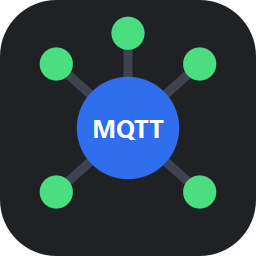

<a id="readme-top"></a>

<!-- PROJECT SHIELDS -->
[![CI][ci-shield]][ci-url]
[![Release][release-shield]][release-url]
[![Downloads][downloads-shield]][release-url]
[![Issues][issues-shield]][issues-url]
[![MIT License][license-shield]][license-url]

<!-- PROJECT LOGO -->
<br />
<div align="center">
  <a href="https://github.com/danieltak/MQTT-Broker">
    
  </a>

  <h3 align="center">MQTT Broker</h3>

  <p align="center">
    A desktop MQTT broker with a clean dark-mode GUI to watch topics, inspect payloads and see connected devices in real time.
    <br />
    <a href="#usage"><strong>Explore the docs »</strong></a>
    <br />
    <br />
    <a href="https://github.com/danieltak/MQTT-Broker/releases/latest">Download</a>
    &middot;
    <a href="https://github.com/danieltak/MQTT-Broker/issues/new?labels=bug">Report Bug</a>
    &middot;
    <a href="https://github.com/danieltak/MQTT-Broker/issues/new?labels=enhancement">Request Feature</a>
  </p>
</div>


<!-- TABLE OF CONTENTS -->
<details>
  <summary>Table of Contents</summary>
  <ol>
    <li>
      <a href="#about-the-project">About The Project</a>
      <ul>
        <li><a href="#features">Features</a></li>
        <li><a href="#built-with">Built With</a></li>
      </ul>
    </li>
    <li>
      <a href="#getting-started">Getting Started</a>
      <ul>
        <li><a href="#download-windows">Download (Windows)</a></li>
        <li><a href="#prerequisites">Prerequisites</a></li>
        <li><a href="#installation">Installation</a></li>
      </ul>
    </li>
    <li>
      <a href="#usage">Usage</a>
      <ul>
        <li><a href="#start-the-broker">Start the broker</a></li>
        <li><a href="#inspect-topics-and-payloads">Inspect topics and payloads</a></li>
        <li><a href="#see-connected-devices">See connected devices</a></li>
        <li><a href="#export-to-csv">Export to CSV</a></li>
        <li><a href="#arrange-the-workspace">Arrange the workspace</a></li>
      </ul>
    </li>
    <li><a href="#development">Development</a></li>
    <li><a href="#release-process">Release Process</a></li>
    <li><a href="#roadmap">Roadmap</a></li>
    <li><a href="#contributing">Contributing</a></li>
    <li><a href="#license">License</a></li>
    <li><a href="#contact">Contact</a></li>
    <li><a href="#acknowledgments">Acknowledgments</a></li>
  </ol>
</details>


<!-- ABOUT THE PROJECT -->
## About The Project

[![MQTT Broker Screen Shot][product-screenshot]](https://github.com/danieltak/MQTT-Broker)

MQTT Broker is a self-contained MQTT 3.1.1 broker for Windows with a built-in monitor. Start it on your machine,
point your devices, PLCs, gateways or test clients at it, and immediately see every topic, every message and every
subscriber, without installing a separate broker and a separate MQTT explorer.

It is designed for development benches, commissioning and troubleshooting:

* Bind to **loopback** for local testing, or to a specific **Ethernet / Wi‑Fi adapter** (or all interfaces) to accept devices on the network.
* Every received payload is kept as **raw bytes**, so binary protocols can be inspected in **HEX** while text and JSON are shown as **UTF‑8**.
* A configurable **history limit per topic** keeps memory bounded on busy networks.
* Topic history can be **exported to CSV** with timestamps for offline analysis.

<p align="right">(<a href="#readme-top">back to top</a>)</p>

### Features

* **Configurable listener** – choose interface (loopback, all interfaces or a specific adapter) and TCP port.
* **Live topic tree** – topics grouped by `/` levels with per-topic message counts.
* **Message history** – timestamp, size, QoS, retain flag and publishing client for each message.
* **UTF‑8 / HEX toggle** – switch the table and payload viewer between text and hex at any time.
* **Configurable retention** – limit how many messages are kept per topic (1 – 1,000,000).
* **Connected devices** – client ID, address, status, connection time and each client's subscriptions with QoS.
* **CSV export** – all topics or the selected topic, one row per message.
* **Dockable layout** – move, resize, tab, float or hide every panel; reset with one click.
* **Dark theme** – modern, clean and easy on the eyes during long sessions.
* **Settings remembered** – interface, port and history limit are restored on the next start.

<p align="right">(<a href="#readme-top">back to top</a>)</p>

### Built With

* [![Python][Python-badge]][Python-url]
* [![Qt][Qt-badge]][Qt-url]
* [![amqtt][amqtt-badge]][amqtt-url]
* [![pytest][pytest-badge]][pytest-url]
* [![Ruff][ruff-badge]][ruff-url]
* [![GitHub Actions][gha-badge]][gha-url]

<p align="right">(<a href="#readme-top">back to top</a>)</p>


<!-- GETTING STARTED -->
## Getting Started

### Download (Windows)

The easiest way to use MQTT Broker is the prebuilt Windows app:

1. Download `MQTTBroker-vX.Y.Z-windows-x64.zip` from the [latest release][release-url].
2. Extract the zip anywhere (for example `C:\Tools\MQTTBroker`).
3. Run `MQTTBroker.exe`.

> [!NOTE]
> The first time the broker listens on a network adapter, Windows Firewall may ask for permission. Allow access on
> the networks your devices use; loopback-only use needs no firewall rule.

### Prerequisites

To run from source you need:

* Python 3.11 or newer (3.14 recommended)
* Git

### Installation

1. Clone the repo
   ```sh
   git clone https://github.com/danieltak/MQTT-Broker.git
   cd MQTT-Broker
   ```
2. Create and activate a virtual environment
   ```powershell
   python -m venv .venv
   .\.venv\Scripts\Activate.ps1
   ```
3. Install the app
   ```sh
   pip install -r requirements.txt
   pip install -e .
   ```
4. Start it
   ```sh
   python -m mqtt_broker
   ```
   or simply `mqtt-broker`.

<p align="right">(<a href="#readme-top">back to top</a>)</p>


<!-- USAGE EXAMPLES -->
## Usage

### Start the broker

1. Pick the **Interface** in the toolbar:
   * `Loopback (127.0.0.1)` – only this computer can connect.
   * `All interfaces (0.0.0.0)` – any network the computer is on.
   * `<Adapter name> (<IP>)` – only that Ethernet / Wi‑Fi adapter. Use ⟳ to refresh the list after plugging in a cable.
2. Set the **Port** (default `1883`).
3. Click **Start**. The status pill turns green and shows the address, e.g. `Running on 127.0.0.1:1883`.

If the port is already in use, the status turns red and the reason is shown in the status bar.

Try it with any MQTT client, for example with [mosquitto clients](https://mosquitto.org/download/):

```sh
mosquitto_sub -h 127.0.0.1 -p 1883 -t "plant/#" -i hmi-panel-01
mosquitto_pub -h 127.0.0.1 -p 1883 -t plant/line1/temperature -m '{"value": 72.4, "unit": "C"}' -q 1
```

or with Python ([paho-mqtt](https://pypi.org/project/paho-mqtt/)):

```python
import paho.mqtt.publish as publish

publish.single("plant/line1/temperature", b'{"value": 72.4}', hostname="127.0.0.1", port=1883, qos=1)
```

> [!WARNING]
> The broker accepts anonymous connections. When binding to a network adapter, anyone who can reach that address can
> publish and subscribe. Use it on trusted networks only.

### Inspect topics and payloads

Select a topic in the **Topics** panel to see its history in **Messages**. Selecting a message shows the full payload
below. Use **UTF‑8 / HEX** to switch representation — useful for binary frames from gateways and serial bridges:

![HEX view][screenshot-hex]

The **History** field in the toolbar sets how many messages are kept *per topic*; older messages are discarded
first. Lowering it trims existing history immediately.

### See connected devices

The **Clients** panel lists every client with its address, status and connection time. Expand a client to see the
topic filters it subscribed to and the granted QoS. Disconnected clients stay listed (greyed out) until the broker is
stopped.

### Export to CSV

* **Export CSV** (Topics panel) exports every topic.
* **Export topic** (Messages panel) exports only the selected topic.

Each message becomes one row, grouped by topic and ordered by time:

| topic | timestamp | payload_hex | payload_utf8 | qos | retain | client_id |
|---|---|---|---|---|---|---|
| plant/line1/temperature | 2026-11-12T11:21:26.218-03:00 | 7B 22 76 61 … | {"value": 75.57, …} | 1 | 0 | plc-line1 |

The file is UTF‑8 with BOM so it opens correctly in Excel. Cells that would start a spreadsheet formula are prefixed
with `'` to prevent CSV injection.

### Arrange the workspace

Every panel (Topics, Messages, Payload, Clients) is a dock: drag its title bar to move it, drop it onto another panel
to create tabs, double-click to float it, or close it. Use the **View** menu to show hidden panels, **Reset layout**,
or toggle **Full screen** (`F11`).

![Docked and tabbed layout][screenshot-docking]

Settings (interface, port, history limit) are stored in `%APPDATA%\mqtt_broker\config.json`.

<p align="right">(<a href="#readme-top">back to top</a>)</p>


<!-- DEVELOPMENT -->
## Development

Install the development tools:

```sh
pip install -r requirements-dev.txt
pip install -e .
```

| Task | Command |
|---|---|
| Run the app | `python -m mqtt_broker` |
| Run all tests | `pytest` |
| Lint | `ruff check .` |
| Type check | `pyright` |
| Build the Windows app | `.\packaging\build.ps1 -Version 0.1.1` |

The test suite covers the message store, CSV export, configuration, network adapter discovery, a real broker with
real MQTT clients, and the GUI end to end with [pytest-qt](https://pytest-qt.readthedocs.io/) (start/stop, topics,
HEX/UTF‑8, clients, history limit, export, docking and full screen).

> [!TIP]
> If the project lives in a OneDrive/Dropbox folder, build outside it to avoid file locks:
> `.\packaging\build.ps1 -Version 0.1.1 -DistPath "$env:TEMP\mqtt\dist" -WorkPath "$env:TEMP\mqtt\build"`

Project layout:

```text
src/mqtt_broker/
├── broker_service.py   # amqtt broker on its own asyncio thread
├── plugin.py           # amqtt plugin capturing messages, clients and subscriptions
├── store.py            # thread-safe per-topic history (bytes) and client registry
├── exporter.py         # CSV export
├── network.py          # adapter discovery and port checks
├── config.py           # persisted settings
├── controller.py       # Qt signal bridge between broker thread and GUI
└── gui/                # PySide6 main window, docks, models and dark theme
tests/                  # unit, broker integration and GUI tests
packaging/              # PyInstaller build script for the Windows app
```

<p align="right">(<a href="#readme-top">back to top</a>)</p>


<!-- RELEASE PROCESS -->
## Release Process

Every push and pull request runs **CI**: Ruff and Pyright first, then the tests on Windows and Ubuntu with
Python 3.11 and 3.14.

Releases are created manually with the **Release** workflow:

1. Bump the version in `pyproject.toml` and `src/mqtt_broker/__init__.py`.
2. Run **Actions → Release → Run workflow**.
3. The workflow runs CI, builds and smoke-tests the Windows app, and a **GitHub Copilot agent reviews the changes**
   since the previous release and writes the changelog (shown in the run summary).
4. A maintainer reviews the changelog and **approves the deployment** — only then is the GitHub Release published with
   the zip and the changelog as release notes.

<p align="right">(<a href="#readme-top">back to top</a>)</p>


<!-- ROADMAP -->
## Roadmap

- [x] Configurable interface and port
- [x] Topic tree with per-topic history stored as bytes
- [x] UTF‑8 / HEX payload view
- [x] Connected clients and subscriptions
- [x] CSV export
- [x] Dockable dark-mode GUI
- [x] Windows release with AI-generated changelog
- [ ] Username / password authentication
- [ ] TLS and WebSocket listeners
- [ ] Publish test messages from the GUI
- [ ] Topic search / filter
- [ ] Remember the dock layout between sessions
- [ ] Linux and macOS builds

See the [open issues][issues-url] for a full list of proposed features (and known issues).

<p align="right">(<a href="#readme-top">back to top</a>)</p>


<!-- CONTRIBUTING -->
## Contributing

Contributions are what make the open source community such an amazing place to learn, inspire, and create. Any
contributions you make are **greatly appreciated**.

If you have a suggestion that would make this better, please fork the repo and create a pull request. You can also
simply open an issue with the tag "enhancement". Don't forget to give the project a star! Thanks again!

1. Fork the Project
2. Create your Feature Branch (`git checkout -b feature/AmazingFeature`)
3. Make sure `ruff check .`, `pyright` and `pytest` pass
4. Commit your Changes (`git commit -m 'Add some AmazingFeature'`)
5. Push to the Branch (`git push origin feature/AmazingFeature`)
6. Open a Pull Request

### Top contributors:

<a href="https://github.com/danieltak/MQTT-Broker/graphs/contributors">
  
</a>

<p align="right">(<a href="#readme-top">back to top</a>)</p>


<!-- LICENSE -->
## License

Distributed under the MIT License. See [`LICENSE`](LICENSE) for more information.

The Windows release bundles Qt for Python (PySide6), which is licensed under the LGPL‑3.0; the Qt libraries are shipped
as separate, replaceable DLLs. See `THIRD_PARTY_NOTICES.txt` in the release zip.

<p align="right">(<a href="#readme-top">back to top</a>)</p>


<!-- CONTACT -->
## Contact

Daniel Watanabe - [@danieltak](https://github.com/danieltak)

Project Link: [https://github.com/danieltak/MQTT-Broker](https://github.com/danieltak/MQTT-Broker)

<p align="right">(<a href="#readme-top">back to top</a>)</p>


<!-- ACKNOWLEDGMENTS -->
## Acknowledgments

* [amqtt](https://github.com/Yakifo/amqtt) – the asyncio MQTT broker powering the backend
* [Qt for Python](https://doc.qt.io/qtforpython-6/) – the GUI toolkit
* [psutil](https://github.com/giampaolo/psutil) – network adapter discovery
* [Eclipse Paho](https://eclipse.dev/paho/) – MQTT client used in the tests
* [PyInstaller](https://pyinstaller.org/) – Windows packaging
* [Best-README-Template](https://github.com/othneildrew/Best-README-Template) – the template for this README
* [Img Shields](https://shields.io)

<p align="right">(<a href="#readme-top">back to top</a>)</p>


<!-- MARKDOWN LINKS & IMAGES -->
[ci-shield]: https://img.shields.io/github/actions/workflow/status/danieltak/MQTT-Broker/ci.yml?branch=main&style=for-the-badge&label=CI
[ci-url]: https://github.com/danieltak/MQTT-Broker/actions/workflows/ci.yml
[release-shield]: https://img.shields.io/github/v/release/danieltak/MQTT-Broker?style=for-the-badge
[release-url]: https://github.com/danieltak/MQTT-Broker/releases/latest
[downloads-shield]: https://img.shields.io/github/downloads/danieltak/MQTT-Broker/total?style=for-the-badge
[issues-shield]: https://img.shields.io/github/issues/danieltak/MQTT-Broker.svg?style=for-the-badge
[issues-url]: https://github.com/danieltak/MQTT-Broker/issues
[license-shield]: https://img.shields.io/github/license/danieltak/MQTT-Broker.svg?style=for-the-badge
[license-url]: https://github.com/danieltak/MQTT-Broker/blob/main/LICENSE
[product-screenshot]: images/screenshot-overview.png
[screenshot-hex]: images/screenshot-hex.png
[screenshot-docking]: images/screenshot-docking.png
[Python-badge]: https://img.shields.io/badge/Python-3776AB?style=for-the-badge&logo=python&logoColor=white
[Python-url]: https://www.python.org/
[Qt-badge]: https://img.shields.io/badge/PySide6%20(Qt)-41CD52?style=for-the-badge&logo=qt&logoColor=white
[Qt-url]: https://doc.qt.io/qtforpython-6/
[amqtt-badge]: https://img.shields.io/badge/amqtt-660066?style=for-the-badge&logo=mqtt&logoColor=white
[amqtt-url]: https://github.com/Yakifo/amqtt
[pytest-badge]: https://img.shields.io/badge/pytest-0A9EDC?style=for-the-badge&logo=pytest&logoColor=white
[pytest-url]: https://pytest.org/
[ruff-badge]: https://img.shields.io/badge/Ruff-D7FF64?style=for-the-badge&logo=ruff&logoColor=black
[ruff-url]: https://docs.astral.sh/ruff/
[gha-badge]: https://img.shields.io/badge/GitHub%20Actions-2088FF?style=for-the-badge&logo=githubactions&logoColor=white
[gha-url]: https://github.com/features/actions
